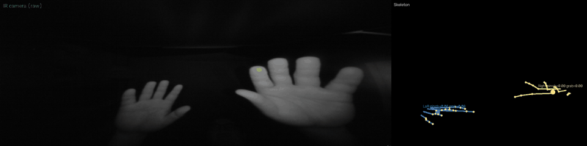

# Leap Motion (Linux) Revival Kit

Ultraleap (the company behind Leap Motion / Gemini) was dismantled and sold off
in 2025 — the hand-tracking business went to ROLI, haptics/XR IP went to SIM IP.
As a result, most of the infrastructure that used to make the **original Leap
Motion Controller** (USB `f182:0003`) work on Linux is now dead or broken:

- `repo.ultraleap.com` (the official APT repo) — **DNS doesn't resolve at all anymore.**
- `developer.leapmotion.com`, `leapmotion.com`, `support.ultraleap.com` — **all dead.**
- The rebranded portal, `leapmotiontechnology.com`, still has a download page, but
  the free-developer-account signup flow was broken when we tried it (July 2026).
- Even once you *do* get the software installed, the vendor's own shipped
  **udev rule is malformed** and silently denies USB access — see below.

This repo collects everything needed to get the original Leap Motion Controller
working on a modern Linux box (Ubuntu 24.04, and Arch Linux on Wayland/Hyprland) anyway, using an
**archived (Wayback Machine) snapshot of the dead apt repo** — no account, no
signup, nothing proprietary redistributed here. It's for fellow developers and
anyone who still has one of these devices sitting in a drawer.

## Demo



Real-time output of [`examples/live_visualizer.py`](examples/live_visualizer.py) —
raw IR camera feed (the actual captured hand shape) side by side with the
palm + finger-bone skeleton and live pinch/grab scores, both hands tracked
simultaneously. No Unity, no official Control Panel (see below for why that
doesn't work), just the LeapC Python bindings + OpenCV.

## What's here

| Path | What |
|---|---|
| [`install.sh`](install.sh) | Fetches the Gemini v5.17.1.0 `.deb`s from the Wayback Machine and installs them: as a real pacman package on Arch, via `dpkg` on Debian/Ubuntu. Applies the udev fix below and enables the service |
| [`packaging/arch/`](packaging/arch/) | `PKGBUILD` that repackages the `.deb`s for Arch (merged-`/usr` layout, `leap` user via sysusers.d, fixed udev rule, control-panel lock fix) |
| [`scripts/setup-python.sh`](scripts/setup-python.sh) | Creates `.venv`, builds the LeapC Python bindings against the installed service, installs example deps |
| [`scripts/inspect-debs.sh`](scripts/inspect-debs.sh) | Unpacks the archived `.deb`s and reports checksums, dependencies, maintainer scripts and missing shared libraries (for maintaining the PKGBUILD) |
| [`udev/99-leapmotion-fix.rules`](udev/99-leapmotion-fix.rules) | Corrects the broken vendor udev rule on Debian/Ubuntu (see "The udev bug" below) |
| [`examples/hand_test.py`](examples/hand_test.py) | Minimal script printing pinch/grab scores + finger-extension state per frame |
| [`examples/live_visualizer.py`](examples/live_visualizer.py) | Real-time OpenCV visualization: raw IR camera feed + skeleton (palm, finger bones, pinch/grab overlay) side by side — replaces the official Control Panel visualizer, which fails to launch (see below) |
| [`docs/RESOURCES.md`](docs/RESOURCES.md) | Curated list of every SDK/driver/binding/community-project resource we found for this device |
| [`docs/SDK_CAPABILITIES.md`](docs/SDK_CAPABILITIES.md) | What the LeapC/Gemini API actually exposes (skeletal tracking fields, raw stereo images, multi-device, recording/playback, etc.), read straight from the `leapc-python-bindings` source and verified against real hardware |

## Quickstart

```bash
git clone https://github.com/ohora23/leap-motion-linux-revival.git
cd leap-motion-linux-revival
./install.sh                 # add --no-control-panel to skip the Unity GUI
./scripts/setup-python.sh    # venv + LeapC Python bindings
source .venv/bin/activate
python examples/live_visualizer.py
```

`install.sh` detects your distro. On **Arch** it builds pacman packages from
[`packaging/arch/PKGBUILD`](packaging/arch/PKGBUILD) (needs `base-devel`) and
installs them with `pacman -U`. On **Debian/Ubuntu** it installs the `.deb`s
with `dpkg`. Either way you get `ultraleap-hand-tracking-service` 5.17.1.0 (+
`ultraleap-hand-tracking-control-panel` 3.4.1), a working udev rule, and the
service enabled at boot. It will ask for `sudo`. Run it as your normal user.

<details>
<summary>Manual Python setup (what <code>scripts/setup-python.sh</code> does)</summary>

```bash
git clone https://github.com/ohora23/leapc-python-bindings.git
cd leapc-python-bindings
python3 -m venv .venv && source .venv/bin/activate
pip install -r requirements.txt          # build, cffi, opencv-python, numpy
python -m build leapc-cffi               # builds against /usr/include/LeapC.h +
                                          # /usr/lib/ultraleap-hand-tracking-service/libLeapC.so
pip install leapc-cffi/dist/leapc_cffi-0.0.1-*.whl
pip install -e leapc-python-api
python ../leap-motion-linux-revival/examples/live_visualizer.py
```

</details>

We clone from [`ohora23/leapc-python-bindings`](https://github.com/ohora23/leapc-python-bindings)
— an unmodified fork of the original
[`ultraleap/leapc-python-bindings`](https://github.com/ultraleap/leapc-python-bindings) —
rather than the upstream org directly. Given Ultraleap the company no longer
exists (see above), there's a real risk the `ultraleap` GitHub org itself gets
deleted or archived someday the way `repo.ultraleap.com` already has; this fork
is a preservation copy so the Quickstart above keeps working either way.

(The bindings repo ships a precompiled module, but only for Python 3.8 — on
anything newer, e.g. Ubuntu 24.04's Python 3.12, you need to build it yourself
as above. It just works once you do; no code changes needed.)

## Webcam instead of a Leap

Orion Renewal can use a plain webcam as the tracking source (MediaPipe hand landmarks, about 30 fps):

```sh
pip install -e "application[webcam]"        # adds mediapipe + OpenCV
# ~/.config/orion-renewal/config.toml
#   [general]  source = "webcam"
#   [webcam]   device = "auto"   # or "/dev/video2"; Settings → Tracking source lists the detected cameras
```

The first start downloads Google's `hand_landmarker.task` (about 7 MB) to `~/.cache/orion-renewal/`. Restart after
changing the source. Hold your hand upright toward the camera (fingers up, palm facing it): `tilt = 90` lays it
flat for the gestures, as if it were over a Leap. Limits: thumbs up/down read as thumb-forward/back, because the tilt
turns "up" into "away". OrionDo opens with an open palm on the webcam (`[webcam] trigger`); distance is estimated from how big the hand looks, so zoom and swipe lengths are
approximate; the fingertip is noisier than the Leap's, so OrionDo may want a larger `deadzone`/`tap_trigger`.

## Arch Linux + Wayland (Hyprland) notes

- **Packaging, not `dpkg`.** Arch has no `dpkg`/`apt`, and extracting a `.deb`
  over `/` would leave files pacman doesn't know about. The PKGBUILD unpacks the
  archived `.deb`s and fixes what doesn't fit Arch:
  - Debian's `/lib`, `/sbin` and `/usr/sbin` trees move under `/usr/lib` and
    `/usr/bin`. On Arch those top-level paths are symlinks, and pacman refuses
    packages that ship files there.
  - Debian maintainer scripts don't run under pacman, so the package
    reimplements them:
    - the `leap` service user comes from `sysusers.d`;
    - ownership of `/etc/ultraleap`, `/var/log/ultraleap` and
      `/usr/share/ultraleap` comes from `tmpfiles.d`;
    - the config file is seeded at build time instead of from
      `/usr/TrackingService`;
    - the `libLeapC.so` links go in `/usr/lib` instead of Debian's multiarch
      directory.

    The originals are kept for reference in
    `/usr/share/doc/ultraleap-hand-tracking-service/debian/`.
  - **EULA.** On Debian the package asked for licence acceptance during install
    and ran `leapctl eula -y`. pacman can't ask questions, so `install.sh` asks
    after starting the service (or pass `--accept-eula`). By hand: `leapctl eula`
    to read it, `leapctl eula -y` to accept.
  - The vendor's broken `99-LMC.rules`, `99-LMC2.rules` and `99-SIR170.rules`
    (all with the same bug, and Arch has no `plugdev` group either) are dropped
    and replaced with `70-leapmotion.rules`:
    `GROUP="leap", MODE="0660", TAG+="uaccess"`. The service user gets
    read/write access, your logged-in desktop session gets an ACL, and the
    device isn't world-writable.
  - The control panel's `unity.lock` ships writable, so the GUI can start.

  Uninstall with `sudo pacman -R ultraleap-hand-tracking-control-panel ultraleap-hand-tracking-service`.
- **Python.** Arch's system Python is externally managed (PEP 668), so
  everything goes in `.venv`. `setup-python.sh` builds the bindings against
  whatever Python version you have.
- **Wayland.** The tracking service is headless and doesn't care about the
  display server. The GUI pieces are X11 clients and run under **XWayland**
  (enabled by default on Hyprland):
  - `examples/live_visualizer.py` uses pip's `opencv-python`, whose bundled Qt
    has only the X11 (`xcb`) backend. The script sets `QT_QPA_PLATFORM=xcb`
    automatically when it detects Wayland. Set the variable yourself to
    override.
  - The Unity control panel is an X11 app too.
- **Checking the device.** `lsusb` comes from `usbutils`, which a minimal Arch
  install lacks. `install.sh` falls back to sysfs. You can also check with
  `udevadm info -q property -n /dev/bus/usb/<bus>/<dev>` and
  `getfacl /dev/bus/usb/<bus>/<dev>`.

## The udev bug

Ultraleap's own shipped rule, `/lib/udev/rules.d/99-LMC.rules`, looks like this:

```
SUBSYSTEM=="usb", ATTRS{idVendor}=="f182", ATTRS{idProduct}=="0003"

GROUP="plugdev"
```

That blank line matters: udev parses each non-empty line as a *separate* rule.
So the match line has no assignment (does nothing), and `GROUP="plugdev"` is a
second rule with no match criteria at all. The device node never actually gets
`plugdev` group ownership, so the tracking service — which runs as an
unprivileged `leap` system user — can never open it:

```
[console] open()#307:  Failed to open LMC. Going to retry. Error: Could not open device.
[console] open()#375:  Failed to open the LMC, due to: Failed to read value from address: 98
```

Fix on Debian/Ubuntu: add a corrected rule as an override (don't touch the
vendor file). `install.sh` does this automatically, or run it by hand (on Arch
the package replaces the vendor rule instead, see above):

```bash
sudo cp udev/99-leapmotion-fix.rules /etc/udev/rules.d/
sudo udevadm control --reload-rules
sudo udevadm trigger --subsystem-match=usb --action=add
sudo systemctl restart ultraleap-hand-tracking-service
```

## Why the Control Panel GUI doesn't launch

`ultraleap-hand-tracking-control-panel` is a Unity app installed to
`/opt/ultraleap-hand-tracking-control-panel/`, owned by `root:root`. On launch
it tries to create its own single-instance lock file *inside that directory*:

```
Error opening /opt/ultraleap-hand-tracking-control-panel/unity.lock: Permission denied
```

Since a normal user can't write there, it never starts. You can `sudo touch`
+ `chmod 666` that lock file as a workaround, or just use
`examples/live_visualizer.py` in this repo instead — it needed neither Unity
nor root.

## Verified working (2026-07-13, Ubuntu 24.04, original Leap Motion Controller)

- Service: Gemini v5.17.1.0, device firmware 1.7.0, detected as `LMC`.
- ~114 FPS tracking events over the Python bindings.
- Two-hand tracking, `pinch_strength`/`grab_strength` scores, and per-finger
  `is_extended` flags all verified live: open hand → all fingers extended,
  `pinch=0.00 grab=0.00`; closed fist → all fingers retracted,
  `pinch≈0.6–1.0 grab≈0.8–1.0`.
- `IMUEvent`/`EyesEvent`/`HeadPoseEvent` exist in the API but are presumed to
  be Leap Motion Controller 2-only hardware features — not yet confirmed
  either way on the original controller.

## A note on licensing

This repo does **not** redistribute Ultraleap's proprietary binaries. The
`install.sh` script fetches them at install time from a public Wayback Machine
snapshot of what was, until 2025, Ultraleap's own freely-downloadable (free
developer license, non-commercial) apt repository. Everything actually
committed to this repo (the udev rule, the example scripts, the docs) is
original and MIT-licensed — see [`LICENSE`](LICENSE).

`examples/*.py` use the `leap` Python module from
[`ultraleap/leapc-python-bindings`](https://github.com/ultraleap/leapc-python-bindings)
(Apache License 2.0), cloned via our unmodified preservation fork
[`ohora23/leapc-python-bindings`](https://github.com/ohora23/leapc-python-bindings) —
that package is **not vendored in this repo**; the Quickstart above has you
`git clone` it separately, so its license applies to it independently (still
Apache 2.0, unchanged by forking) and isn't affected by this repo's MIT
license. The example scripts themselves were written from scratch for this
project (not copied from that repo's own examples) — they just follow the
`leap.Listener` subclassing pattern the library's API requires, which is
standard usage boilerplate rather than copyrightable expression.

## Contributing

Found this useful, hit a different bug, or have this working on another
distro? PRs and issues welcome.

If you touch the Arch packaging, run `scripts/inspect-debs.sh` and check its
report (`inspect-report.txt`) for missing shared libraries or new maintainer
script behaviour that the PKGBUILD needs to replicate.
